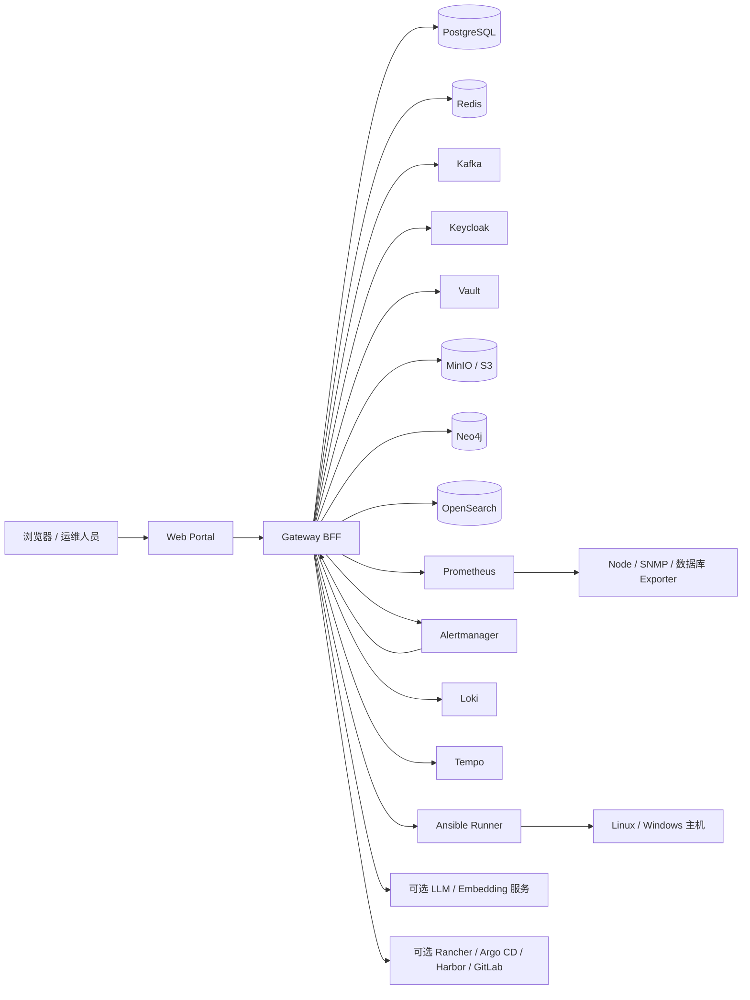

# CMDB 智能运维平台部署手册

> 版本：V1.5
> 更新日期：2026-10-19
> 适用版本：网关 `1.0.230`、门户 `1.0.180`
> 覆盖范围：单机 Docker Compose、生产 Kubernetes、系统初始化、中间件、业务服务、升级、备份和验收

## 1. 文档目标与结论

本文档提供两套可落地的部署方式：

1. **单机 Docker Compose**：一台 Linux 服务器上启动平台业务服务、全部核心中间件和可观测组件，适合 POC、测试、演示、边缘节点和小规模内部使用。
2. **Kubernetes**：从操作系统初始化开始，部署高可用集群、持久化存储、中间件、可观测性和平台业务服务，适合生产或准生产环境。

资源结论：

| 场景 | 最低资源 | 推荐资源 | 结论 |
|---|---:|---:|---|
| 单机 Compose | 16 vCPU / 64 GB / 1 TB NVMe | 24 vCPU / 96 GB / 2 TB NVMe | 满足功能和验收，但无高可用；OpenSearch、Prometheus、Loki 的副本和保留周期需按磁盘调整 |
| K8s 最小生产 | 3 × 8C/16G + 3 × 16C/32G，2 TB 分布式存储 | 3 × 8C/16G + 3 × 32C/64G，4 TB 以上 NVMe | 满足平台、核心中间件和基础可观测性 |
| 当前 `ops-qa` | 3 × 8C/16G + 5 × 32C/64G，合计 184C/368G | 当前环境 | 已满足现有负载；节点请求率约 31%，限制率约 63%，仍有扩容余量 |

当前 `ops-qa` 已运行的 PVC 申请容量约 **2.9 TB**。Longhorn 默认多副本，实际原始盘容量应显著高于该数字，生产建议规划 **4 TB 以上可用 NVMe**，并单独规划备份存储。

## 2. 平台架构



### 2.1 组件清单

| 分类 | 组件 | 作用 | 单机 Compose | K8s |
|---|---|---|---|---|
| 业务 | Gateway BFF | 认证、API、权限、业务编排 | 包含 | `deploy/k8s/ops-qa-platform.yaml` |
| 业务 | Web Portal | Vue 门户和静态资源服务 | 包含 | `deploy/k8s/ops-qa-platform.yaml` |
| 业务 | Ansible Runner | 任务执行、Playbook、日志归档 | 包含 | `deploy/runner/k8s/runner.yaml` |
| 身份 | Keycloak | OIDC 登录、Realm、角色和组 | 包含 | Bitnami Keycloak |
| 数据 | PostgreSQL | 平台数据、Keycloak 数据 | 包含 | CloudNativePG |
| 缓存 | Redis | 会话缓存、远程终端租约 | 包含 | Bitnami Redis Cluster |
| 消息 | Kafka | 资产、告警、任务、工单、发布事件 | 包含 | Bitnami Kafka |
| 密钥 | Vault | SSH/云平台凭据 | 包含 | Vault HA Raft |
| 对象存储 | MinIO / S3 | 知识附件、任务归档 | 包含 | MinIO Operator |
| 图数据库 | Neo4j | 资产关系投影 | 包含 | `neo4j-opensearch.yaml` |
| 搜索 | OpenSearch | 资产全文检索 | 包含 | `neo4j-opensearch.yaml` |
| 监控 | Prometheus | 指标采集与规则计算 | 包含 | `deploy/monitoring/k8s/workloads.yaml` |
| 告警 | Alertmanager | 告警分组、抑制和 webhook | 包含 | `deploy/monitoring/k8s/workloads.yaml` |
| 可视化 | Grafana | 指标、日志和链路大屏 | 包含 | `deploy/monitoring/k8s/workloads.yaml` |
| 日志 | Loki + Alloy | 日志存储和采集 | Loki 包含；Alloy 为集群 DaemonSet | `observability-logging.yaml` |
| 链路 | Tempo | OTLP 链路追踪 | 包含 | `observability-tracing.yaml` |
| 长期指标 | Thanos | 长期指标和跨集群查询 | 单机可按需扩展 | `observability-thanos.yaml` |
| 集成 | Rancher / Argo CD / Harbor / GitLab | 外部平台集成 | 外部配置 | 外部或独立部署 |
| AI | LLM / Embedding | 知识问答和向量检索 | 外部配置 | 外部配置 |

## 3. 端口与网络

| 端口 | 组件 | 建议暴露范围 |
|---:|---|---|
| 8088 | Web Portal | 业务网或反向代理 |
| 8080 | Gateway | 仅反向代理/内网 |
| 8081 | Keycloak | 业务网或统一入口 |
| 5432 | PostgreSQL | 仅平台内网 |
| 6379 | Redis | 仅平台内网 |
| 9092 | Kafka | 仅受控内网 |
| 8200 | Vault | 仅平台内网或运维网 |
| 9000/9001 | MinIO API/Console | API 仅内网；Console 仅运维网 |
| 7474/7687 | Neo4j HTTP/Bolt | 仅平台内网 |
| 9200 | OpenSearch | 仅平台内网 |
| 9090/9093/3000 | Prometheus/Alertmanager/Grafana | 运维网 |
| 3100/3200/4317/4318 | Loki/Tempo/OTLP | 仅平台内网 |
| 9100/9116/9187/9121 | Exporter | 仅监控网 |
| 8090 | Ansible Runner | 仅 Gateway 内网 |

生产环境建议使用统一域名和 HTTPS 反向代理，只暴露 `443`。数据库、Redis、Kafka、Vault、OpenSearch 不应直接暴露到公网。

## 4. 通用前置条件

| 项目 | 要求 |
|---|---|
| 操作系统 | Ubuntu 22.04 LTS / 24.04 LTS，x86_64 |
| 时间同步 | chrony/systemd-timesyncd，所有节点误差小于 1 秒 |
| DNS | 平台、Keycloak、Harbor 等域名可解析 |
| 文件系统 | 本地 ext4/XFS；PostgreSQL 数据目录禁止 NFS/CIFS/SMB/FUSE |
| 防火墙 | 按第 3 节开放；集群节点之间放通 K8s 和存储端口 |
| 浏览器 | Chrome / Edge 最新版 |
| 证书 | 测试可用自签 CA，生产必须使用受信任证书 |

---

## 5. 方式一：单机 Docker Compose 一键部署

部署包位置：[deploy/single-node](../../deploy/single-node)。

该部署包包含：

- PostgreSQL、Redis、Kafka、Keycloak；
- Vault、MinIO、Neo4j、OpenSearch；
- Prometheus、Alertmanager、Grafana、Loki、Tempo；
- Node Exporter、PostgreSQL Exporter、Redis Exporter、SNMP Exporter；
- Gateway、Web、Ansible Runner。

说明：Rancher、Kubernetes、Argo CD、Harbor、GitLab 和外部 LLM 属于集成目标，不是平台自身启动依赖，因此不在 Compose 内启动。

### 5.1 操作系统初始化

以 Ubuntu 22.04、`/dev/sdb` 作为数据盘为例。执行前必须确认磁盘设备名，避免误格式化。

```bash
sudo hostnamectl set-hostname cmdb-single
sudo timedatectl set-timezone Asia/Shanghai
sudo apt-get update
sudo apt-get install -y ca-certificates curl gnupg jq openssl openssh-client chrony
sudo systemctl enable --now chrony
sudo chronyc tracking
```

数据盘建议使用独立磁盘：

```bash
sudo lsblk
sudo mkfs.xfs /dev/sdb
sudo mkdir -p /opt/cmdb
echo 'UUID='$(sudo blkid -s UUID -o value /dev/sdb)' /opt/cmdb xfs defaults,noatime 0 2' | sudo tee -a /etc/fstab
sudo mount -a
df -h /opt/cmdb
```

安装 Docker 和 Compose 插件：

```bash
sudo install -m 0755 -d /etc/apt/keyrings
curl -fsSL https://download.docker.com/linux/ubuntu/gpg | \
  sudo gpg --dearmor -o /etc/apt/keyrings/docker.gpg
echo \
  "deb [arch=$(dpkg --print-architecture) signed-by=/etc/apt/keyrings/docker.gpg] \
  https://download.docker.com/linux/ubuntu $(. /etc/os-release && echo "$VERSION_CODENAME") stable" | \
  sudo tee /etc/apt/sources.list.d/docker.list >/dev/null
sudo apt-get update
sudo apt-get install -y docker-ce docker-ce-cli containerd.io docker-buildx-plugin docker-compose-plugin
sudo systemctl enable --now docker
docker version
docker compose version
```

如服务器不能访问 Docker Hub，应先将 Compose 中的镜像同步到内部 Harbor，并修改镜像地址。

### 5.2 准备部署包和配置

```bash
sudo mkdir -p /opt/cmdb-src
sudo rsync -a --delete /path/to/CMDB/ /opt/cmdb-src/
cd /opt/cmdb-src/deploy/single-node
sudo cp .env.example .env
sudo vi .env
```

至少修改：

```dotenv
SERVER_HOST=192.168.10.20
KEYCLOAK_PUBLIC_URL=http://192.168.10.20:8081
CMDB_PUBLIC_URL=http://192.168.10.20:8088
CMDB_DATA_DIR=/opt/cmdb
```

如需接入外部 LLM，再填写：

```dotenv
AI_LLM_BASE_URL=https://llm.example.com/v1
AI_LLM_MODEL=your-model
AI_LLM_API_KEY=***
AI_EMBEDDING_BASE_URL=https://embedding.example.com/v1
AI_EMBEDDING_MODEL=your-embedding-model
AI_EMBEDDING_API_KEY=***
AI_EMBEDDING_DIMENSIONS=256
```

不要继续使用 `.env.example` 中的 `CHANGE_ME_*` 密码。`bootstrap.sh` 会自动生成随机密码。

### 5.3 一键初始化

```bash
cd /opt/cmdb-src/deploy/single-node
sudo ./scripts/bootstrap.sh
```

脚本执行内容：

1. 检查 Docker Compose、curl、jq、openssl、ssh-keygen；
2. 为数据库、Redis、Keycloak、MinIO、Neo4j、Grafana、Runner 和 Agent 生成随机密钥；
3. 创建 `/opt/cmdb` 数据目录并修正 PostgreSQL 权限；
4. 生成 `secrets/gateway.env`、`secrets/runner.env` 和 Agent 共享令牌；
5. 构建并启动核心中间件和可观测组件；
6. 初始化并解封 Vault；
7. 创建 Keycloak Realm `cmdb`、客户端 `cmdb-web`、平台权限角色和初始管理员；
8. 启动 Gateway、Web、Runner、Kafka 初始化和 MinIO Bucket 初始化；
9. 等待 Gateway Ready。

初始管理员账号和密码写入 `.env`：

```bash
sudo grep -E '^CMDB_ADMIN_(USERNAME|PASSWORD)=' .env
```

生产环境不要在终端或聊天工具中传播该密码，首次登录后应在 Keycloak 中重置。

### 5.4 启动校验

```bash
cd /opt/cmdb-src/deploy/single-node
sudo docker compose --env-file .env -f docker-compose.yml ps
sudo ./scripts/verify.sh
```

浏览器访问：

```text
平台：http://服务器IP:8088
Keycloak：http://服务器IP:8081
Grafana：http://127.0.0.1:3000（通过 SSH 隧道访问）
Prometheus：http://127.0.0.1:9090（通过 SSH 隧道访问）
```

SSH 隧道示例：

```bash
ssh -L 3000:127.0.0.1:3000 -L 9090:127.0.0.1:9090 -L 9093:127.0.0.1:9093 \
  ops@服务器IP
```

### 5.5 单机系统重启后的操作

```bash
cd /opt/cmdb-src/deploy/single-node
sudo docker compose --env-file .env -f docker-compose.yml up -d
sudo ./scripts/unseal-vault.sh
sudo ./scripts/verify.sh
```

Vault 使用文件存储且默认封存，主机重启后必须解封；解封密钥保存在 `secrets/vault-init.json`，应离线备份。

### 5.6 单机升级

升级前先备份：

```bash
cd /opt/cmdb-src/deploy/single-node
sudo ./scripts/backup.sh before-v1.0.230
```

更新代码或镜像版本后：

```bash
cd /opt/cmdb-src
sudo git pull --ff-only
cd deploy/single-node
sudo ./scripts/update.sh
```

回滚原则：

1. 记录升级前 `CMDB_VERSION`；
2. 修改 `.env` 中 `CMDB_VERSION` 为旧版本；
3. 执行 `docker compose up -d`；
4. 如数据库迁移不兼容，停止写入并使用 `backups/<label>/postgres.sql` 恢复。

### 5.7 单机备份

```bash
sudo ./scripts/backup.sh
```

输出目录默认：

```text
/opt/cmdb/backups/<label>/
├── postgres.sql
├── minio.tar.gz
├── vault.tar.gz
├── neo4j.tar.gz
├── opensearch.tar.gz
└── env.backup
```

备份必须复制到另一台服务器或对象存储。不能把唯一备份放在同一块磁盘上。

### 5.8 单机限制与适用边界

- 单 PostgreSQL、单 Redis、单 Kafka、单 OpenSearch，不具备节点级高可用。
- Vault 需要人工解封。
- 单机故障会影响全部服务。
- 不建议承载核心生产和强 SLA 业务。
- 生产使用请选择 Kubernetes 方式或使用外部高可用中间件。

---

## 6. 方式二：Kubernetes 部署

### 6.1 集群规划

当前验证环境：

| 角色 | 数量 | 单节点配置 | 系统 |
|---|---:|---:|---|
| Control Plane | 3 | 8C / 16 GB / 200 GB | Ubuntu 22.04 |
| Worker | 5 | 32C / 64 GB / 1 TB+ | Ubuntu 22.04 |
| Kubernetes | - | v1.28.15 | containerd 2.2.1 |
| CNI | - | Calico | - |
| 存储 | - | Longhorn | - |

最小生产参考：

| 角色 | 数量 | 单节点配置 |
|---|---:|---:|
| Control Plane | 3 | 8C / 16 GB / 200 GB SSD |
| Worker | 3 | 16C / 32 GB / 500 GB NVMe + 2 TB 数据盘 |

不要把业务和有状态中间件调度到控制平面。控制平面应设置 taint。

### 6.2 操作系统初始化

所有节点执行：

```bash
sudo hostnamectl set-hostname <node-name>
sudo timedatectl set-timezone Asia/Shanghai
sudo apt-get update && sudo apt-get upgrade -y
sudo apt-get install -y curl ca-certificates gnupg jq socat conntrack ipset \
  chrony nfs-common open-iscsi
sudo systemctl enable --now chrony
```

关闭 swap：

```bash
sudo swapoff -a
sudo sed -ri '/\sswap\s/s/^#?/#/' /etc/fstab
```

加载内核模块和网络参数：

```bash
cat <<'EOF' | sudo tee /etc/modules-load.d/k8s.conf
overlay
br_netfilter
EOF
sudo modprobe overlay
sudo modprobe br_netfilter

cat <<'EOF' | sudo tee /etc/sysctl.d/99-kubernetes.conf
net.bridge.bridge-nf-call-iptables=1
net.bridge.bridge-nf-call-ip6tables=1
net.ipv4.ip_forward=1
fs.inotify.max_user_watches=524288
fs.inotify.max_user_instances=512
vm.max_map_count=262144
EOF
sudo sysctl --system
```

防火墙至少放通：

- Control Plane：`6443`、`2379-2380`、`10250-10252`；
- Worker：`10250`、`30000-32767`（如使用 NodePort）；
- Calico：IPIP/VXLAN/BGP 对应协议；
- Longhorn：`3260`、`9500-9504`；
- 节点之间允许 Pod CIDR 和 Service CIDR。

### 6.3 安装 containerd、kubeadm、kubelet

```bash
sudo apt-get install -y apt-transport-https ca-certificates curl gpg
sudo mkdir -p /etc/apt/keyrings
curl -fsSL https://pkgs.k8s.io/core:/stable:/v1.28/deb/Release.key | \
  sudo gpg --dearmor -o /etc/apt/keyrings/kubernetes-apt-keyring.gpg
echo 'deb [signed-by=/etc/apt/keyrings/kubernetes-apt-keyring.gpg] https://pkgs.k8s.io/core:/stable:/v1.28/deb/ /' | \
  sudo tee /etc/apt/sources.list.d/kubernetes.list
sudo apt-get update
sudo apt-get install -y containerd.io kubelet=1.28.15-1.1 kubeadm=1.28.15-1.1 kubectl=1.28.15-1.1
sudo apt-mark hold kubelet kubeadm kubectl
```

配置 containerd 使用 `SystemdCgroup`，然后：

```bash
sudo systemctl restart containerd
sudo systemctl enable --now kubelet
```

### 6.4 初始化高可用控制平面

生产环境使用 VIP + Keepalived/HAProxy，或使用云负载均衡。下面以 `VIP=172.28.69.160`、`CONTROL_PLANE_ENDPOINT=172.28.69.160:6443` 为例。

第一个控制平面：

```bash
cat > kubeadm-config.yaml <<'EOF'
apiVersion: kubeadm.k8s.io/v1beta3
kind: ClusterConfiguration
kubernetesVersion: v1.28.15
controlPlaneEndpoint: "172.28.69.160:6443"
networking:
  serviceSubnet: 10.96.0.0/12
  podSubnet: 10.244.0.0/16
EOF

sudo kubeadm init --config kubeadm-config.yaml --upload-certs
```

配置 `kubectl`：

```bash
mkdir -p $HOME/.kube
sudo cp /etc/kubernetes/admin.conf $HOME/.kube/config
sudo chown $(id -u):$(id -g) $HOME/.kube/config
```

其余控制平面执行 `kubeadm join ... --control-plane --certificate-key ...`，Worker 执行 `kubeadm join ...`。

安装 Calico：

```bash
kubectl apply -f https://raw.githubusercontent.com/projectcalico/calico/v3.28.2/manifests/calico.yaml
kubectl get pods -n kube-system -w
```

移除控制平面业务 taint 仅用于小型测试集群；生产环境应保留：

```bash
kubectl taint nodes --all node-role.kubernetes.io/control-plane-
```

### 6.5 安装基础平台组件

#### 6.5.1 Longhorn

```bash
helm repo add longhorn https://charts.longhorn.io
helm repo update
helm upgrade --install longhorn longhorn/longhorn \
  -n longhorn-system --create-namespace \
  --set defaultSettings.defaultReplicaCount=3
```

确认所有节点 `iscsid` 已启动，StorageClass `longhorn` 可用。

#### 6.5.2 cert-manager

```bash
helm repo add jetstack https://charts.jetstack.io
helm upgrade --install cert-manager jetstack/cert-manager \
  -n cert-manager --create-namespace \
  --set crds.enabled=true
```

#### 6.5.3 CloudNativePG

```bash
helm repo add cnpg https://cloudnative-pg.github.io/charts
helm upgrade --install cnpg cnpg/cloudnative-pg -n cnpg-system --create-namespace
```

生产 PostgreSQL 建议 3 实例、同步或异步复制、每日基础备份到对象存储，并启用 WAL 归档。

#### 6.5.4 MinIO Operator

```bash
helm repo add minio-operator https://operator.min.io
helm upgrade --install minio-operator minio-operator/operator \
  -n minio-operator --create-namespace
```

创建 Tenant 时至少规划：

- 4 个驱动或云盘；
- 100 GiB/盘起步；
- 独立 StorageClass；
- TLS 和访问密钥通过 Secret 注入。

#### 6.5.5 Redis Cluster

推荐 3 主 3 从，密码存入 Secret，开启持久化。单机 Compose 中 Redis 使用单实例；K8s 生产使用 Cluster。

#### 6.5.6 Kafka

推荐 3 broker + 3 controller 的 KRaft 集群，每 broker 至少 200 GiB 数据盘。创建以下 topic：

```text
cmdb.asset.changed.v1
cmdb.relation.changed.v1
discovery.resource.found.v1
monitor.target.changed.v1
alert.state.changed.v1
job.execution.changed.v1
ticket.state.changed.v1
release.state.changed.v1
audit.operation.created.v1
```

#### 6.5.7 Keycloak

建议 2 副本，外部 PostgreSQL，启用 health 和 metrics。必须创建：

- Realm：`cmdb`；
- Client：`cmdb-web`，PKCE、标准授权码；
- Realm 角色：平台权限名，例如 `cmdb:view`、`monitor:manage`、`aiops:execute`；
- 复合角色：`platform-admin`；
- 组映射声明：`project_groups`。

### 6.6 部署 Vault

生产使用 Raft 3 副本：

```bash
helm repo add hashicorp https://helm.releases.hashicorp.com
helm upgrade --install vault hashicorp/vault -n ops-qa \
  --set='server.ha.enabled=true' \
  --set='server.ha.raft.enabled=true' \
  --set='server.ha.replicas=3'
```

初始化、解封、启用 KV：

```bash
kubectl -n ops-qa exec -it vault-0 -- vault operator init
kubectl -n ops-qa exec -it vault-0 -- vault operator unseal <KEY_1>
kubectl -n ops-qa exec -it vault-0 -- vault operator unseal <KEY_2>
kubectl -n ops-qa exec -it vault-0 -- vault operator unseal <KEY_3>
kubectl -n ops-qa exec -it vault-0 -- vault login <ROOT_TOKEN>
kubectl -n ops-qa exec -it vault-0 -- vault secrets enable -path=secret -version=2 kv
```

解封密钥和 Root Token 必须离线保存，不能写入 Git。

### 6.7 部署 Neo4j、OpenSearch 和可观测性

```bash
kubectl apply -f deploy/k8s/neo4j-opensearch.yaml
kubectl apply -f deploy/monitoring/k8s/workloads.yaml
kubectl apply -f deploy/k8s/kube-state-metrics.yaml
kubectl apply -f deploy/k8s/observability-logging.yaml
kubectl apply -f deploy/k8s/observability-tracing.yaml
kubectl apply -f deploy/k8s/observability-thanos.yaml
kubectl apply -f deploy/k8s/monitor-rules-rbac-ops-qa.yaml
```

检查：

```bash
kubectl -n ops-qa get pods
kubectl -n monitoring get pods
kubectl -n ops-qa get pvc
kubectl -n monitoring get pvc
```

### 6.8 创建平台 Secret

不要把密码写入 YAML。推荐从 Vault 或 CI/CD Secret 渲染：

```bash
kubectl -n ops-qa create secret generic cmdb-gateway-env \
  --from-env-file=secrets/gateway.env
kubectl -n ops-qa create secret generic cmdb-registry \
  --from-file=.dockerconfigjson=$HOME/.docker/config.json \
  --type=kubernetes.io/dockerconfigjson
```

至少包含：

```text
DATABASE_URL
REDIS_URL
KAFKA_BROKERS
KEYCLOAK_ISSUER_URL
KEYCLOAK_ADMIN_URL / KEYCLOAK_ADMIN_USERNAME / KEYCLOAK_ADMIN_PASSWORD
SESSION_SECRET
AGENT_SHARED_TOKEN
ANSIBLE_RUNNER_URL
ANSIBLE_RUNNER_TOKEN
PROMETHEUS_URL
ALERTMANAGER_URL
LOKI_URL
TEMPO_URL
THANOS_URL
NEO4J_URL / NEO4J_USERNAME / NEO4J_PASSWORD
OPENSEARCH_URL
S3_ENDPOINT_URL / S3_BUCKET / S3_ACCESS_KEY_ID / S3_SECRET_ACCESS_KEY
VAULT_ADDR / VAULT_TOKEN
AI_LLM_* / AI_EMBEDDING_*
```

### 6.9 部署业务服务

按顺序执行：

```bash
kubectl apply -f deploy/k8s/cmdb.yaml
kubectl apply -f deploy/k8s/ops-qa-platform.yaml
kubectl apply -f deploy/runner/k8s/runner.yaml
kubectl -n ops-qa rollout status deployment/gateway --timeout=300s
kubectl -n ops-qa rollout status deployment/web --timeout=300s
kubectl -n ops-qa rollout status deployment/cmdb-ansible-runner --timeout=300s
```

如使用镜像仓库，先在 `ops-qa-platform.yaml` 修改网关和门户版本：

```text
harbor.qa.bcavt.com/cmdb/gateway-bff:1.0.230
harbor.qa.bcavt.com/cmdb/web-portal:1.0.180
```

### 6.10 K8s 验收

```bash
kubectl -n ops-qa get pods,svc,pvc
kubectl -n ops-qa get endpoints gateway web
curl -fsS http://<gateway-node-ip>:30080/api/v1/health
curl -fsS http://<gateway-node-ip>:30080/api/v1/ready
```

浏览器访问 `https://cmdb.example.com`，完成：

1. Keycloak 登录；
2. 用户、角色、项目组显示；
3. 资产、告警、任务、知识库页面可加载；
4. 知识库上传附件成功；
5. RAG 只引用当前用户有权查看的知识；
6. 日志与指标可在 Grafana 查询。

### 6.11 K8s 升级与回滚

```bash
kubectl -n ops-qa set image deployment/gateway gateway=harbor.qa.bcavt.com/cmdb/gateway-bff:<new>
kubectl -n ops-qa rollout status deployment/gateway --timeout=300s
kubectl -n ops-qa rollout undo deployment/gateway
```

数据库升级前必须：

1. 触发 PostgreSQL 基础备份；
2. 确认 WAL 归档正常；
3. 在测试环境验证迁移；
4. 记录当前 ReplicaSet 镜像和应用版本；
5. 保留旧镜像标签，不使用 `latest` 作为生产回滚目标。

---

## 7. 系统更新与安全基线

### 7.1 操作系统更新

建议每月一次维护窗口：

```bash
sudo apt-get update
sudo apt-get upgrade -y
sudo reboot
```

K8s 节点应逐台排空、升级、重启、回归，再恢复调度：

```bash
kubectl drain <node> --ignore-daemonsets --delete-emptydir-data
sudo apt-get update && sudo apt-get upgrade -y
sudo reboot
kubectl uncordon <node>
```

### 7.2 证书与密码轮换

- Keycloak、门户、网关证书提前 30 天续期；
- PostgreSQL、Redis、Kafka、MinIO、Neo4j、Vault Token 每 90 天或按安全制度轮换；
- Agent 共享令牌和 Runner Token 轮换后同步 Gateway、Agent、Runner；
- Root Token 只用于初始化，日常使用受限策略 Token。

### 7.3 备份与恢复目标

| 数据 | 方式 | 建议 RPO | 建议 RTO |
|---|---|---:|---:|
| PostgreSQL | 每日全备 + WAL 归档 | ≤ 15 分钟 | ≤ 2 小时 |
| MinIO | 版本化或跨桶复制 | ≤ 1 小时 | ≤ 2 小时 |
| Vault | Raft 快照 | ≤ 1 小时 | ≤ 1 小时 |
| Neo4j | 每日 dump | ≤ 24 小时 | ≤ 4 小时 |
| OpenSearch | 快照仓库 | ≤ 24 小时 | ≤ 4 小时 |
| Kafka | 副本 + 关键 topic 保留 | 按业务 | 按业务 |

至少每季度做一次恢复演练，并记录恢复耗时。

## 8. 部署验收清单

- [ ] 操作系统时间同步正常；
- [ ] 所有证书有效期大于 30 天；
- [ ] 数据目录位于本地 XFS/ext4；
- [ ] PostgreSQL、Redis、Kafka、Keycloak、Vault、MinIO 健康；
- [ ] Neo4j、OpenSearch 可连接；
- [ ] Prometheus 能抓取 Gateway、PostgreSQL、Redis 和主机指标；
- [ ] Alertmanager 能向 Gateway 发送 webhook；
- [ ] Loki、Tempo、Grafana 有数据；
- [ ] Web、Gateway、Runner 2/2 或 1/1 Ready；
- [ ] Keycloak 登录、角色和项目组声明正常；
- [ ] 资产、Agent、任务、工单、发布、知识库核心流程通过；
- [ ] 备份文件已复制到独立存储；
- [ ] 完成一次恢复演练。

## 9. 常见故障

| 现象 | 排查 |
|---|---|
| PostgreSQL 启动失败、权限错误 | 检查 `POSTGRES_DATA_DIR` 是否为本地文件系统，目录属主是否为 UID 999 |
| Gateway 401 | 检查 `KEYCLOAK_ISSUER_URL` 与浏览器登录地址是否完全一致 |
| Gateway Ready 失败 | 检查 `DATABASE_URL`、Redis、Kafka、Keycloak 和 Secret |
| 知识附件上传失败 | 检查 MinIO Health、`S3_*` 和 Bucket 权限 |
| 任务执行失败 | 检查 Runner Token、SSH 密钥、known_hosts 和目标主机权限 |
| 监控目标为空 | 检查 `AGENT_SHARED_TOKEN`、`agent-token` 和 Prometheus HTTP SD |
| Vault Ready 失败 | 检查 Vault 是否已解封 |
| 单机重启后业务不可用 | 先执行 `unseal-vault.sh`，再检查容器状态 |
| K8s PVC Pending | 检查 Longhorn、StorageClass、节点磁盘和副本数 |
| 网关滚动更新偶发探针失败 | 检查节点负载、CPU/内存限制和 `/api/v1/ready` 耗时 |
