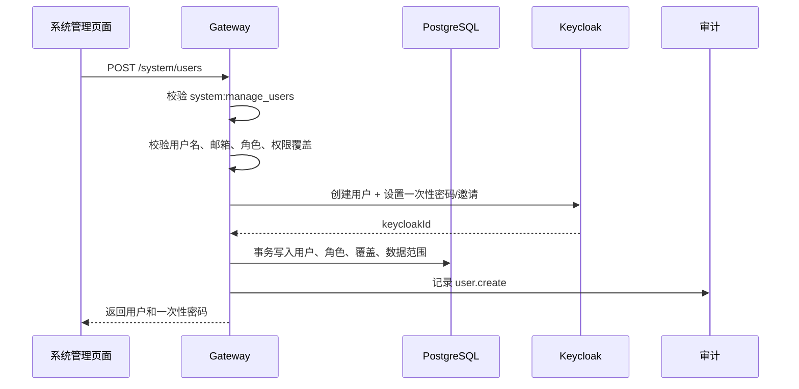
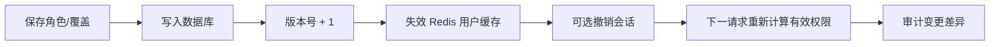
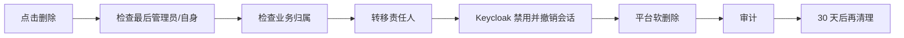

# 系统用户与角色权限中心设计

> 状态：P0/P1 核心能力已实施
> 日期：2026-10-20  
> 范围：用户生命周期、角色、权限目录、按用户授权/拒绝、数据范围、Keycloak 联动、审计和安全约束

## 1. 设计目标

系统管理中心需要从“查看 Keycloak 用户并修改本地数据范围”升级为完整的身份与授权中心，满足：

1. 平台管理员可以新增用户、编辑用户、禁用用户和删除用户。
2. 用户可以选择一个或多个角色。
3. 支持在角色权限基础上，为单个用户额外授予或拒绝权限。
4. 用户的数据范围可以按项目组、标签或全部资产配置。
5. 角色可以新增、复制、修改、停用和删除，并展示影响用户数。
6. 权限变更立即生效，不要求用户重新登录也能在下一请求生效。
7. 所有用户、角色和权限变更写入审计日志。
8. 删除用户前处理其资产、任务、知识文档和其他业务归属。

## 2. 现状与差距

### 2.1 当前已有能力

- 从 Keycloak 同步用户、用户组和 Realm 角色。
- 用户列表、数据范围编辑、账号状态切换。
- 角色权限编辑和数据范围编辑。
- 功能权限与项目组/标签数据范围合并。
- 审计日志、模块配置和生产就绪检查。

### 2.2 当前缺口

| 当前状态 | 目标状态 |
|---|---|
| 只能同步用户，不能新增 | 支持在平台创建 Keycloak 用户 |
| 没有删除用户 | 支持软删除、Keycloak 禁用、30 天回收站 |
| 角色只能改权限，不能增删 | 支持系统角色和自定义角色完整生命周期 |
| 权限只能通过角色获得 | 支持用户直接授权和直接拒绝 |
| 角色为空时无法清空 | 修复 `len(roles)>0` 导致无法清空角色的问题 |
| 权限变更依赖认证缓存过期 | 变更后主动失效缓存，下一请求生效 |
| 缺少最后管理员保护 | 禁止删除/禁用最后一个平台管理员 |
| 删除用户没有业务归属检查 | 删除前展示影响并提供转移 |
| Keycloak 和平台角色容易漂移 | 明确身份源与授权源边界 |

## 3. 核心设计决策

### 3.1 Keycloak 负责身份，平台负责授权

推荐采用：

- **Keycloak**：账号、密码、MFA、登录会话、账号启停；
- **平台 PostgreSQL**：用户角色、权限目录、用户直接授权、数据范围；
- **Gateway**：统一计算有效权限、做服务端鉴权；
- **审计服务**：记录所有身份与授权变更。

原因：

- 角色权限需要按模块和业务资源细粒度配置，放在平台更灵活；
- 用户直接授权/拒绝不适合全部映射成 Keycloak Realm Role；
- 平台可以在不重新签发 Keycloak 角色的情况下立即调整权限；
- Keycloak 仍保留标准 OIDC、MFA、密码策略和会话治理能力。

迁移期兼容：

1. 新增 `authorization_source` 字段，默认 `legacy_keycloak`；
2. 首次启用时把 Keycloak Realm Role 导入平台角色；
3. 管理后台显示迁移状态；
4. 全部用户切换为 `platform` 后，停止把 Keycloak 权限合并进平台权限；
5. `platform-admin` 登录入口仍由 Keycloak 身份角色或平台超级角色保护。

### 3.2 多角色 + 用户级覆盖

有效权限计算：

```text
有效权限 =
  所有已分配角色权限的并集
  + 用户直接允许的权限
  - 用户直接拒绝的权限
```

规则：

- `deny` 优先级最高；
- 用户直接允许可以补足角色没有的权限；
- 用户直接拒绝可以从角色权限中移除权限；
- `platform-admin` 系统角色不可被普通用户覆盖；
- 不允许普通管理员给自己增加 `system:manage` 或 `platform-admin`。

### 3.3 删除是“离职流程”，不是物理删除

删除用户执行：

1. 检查是否最后一个平台管理员；
2. 检查是否有未完成任务、待审批工单、在线会话；
3. 展示资产/知识/任务/工单负责人和创建人影响；
4. 要求转移责任人；
5. 在 Keycloak 中禁用账号并撤销会话；
6. 平台用户状态改为 `deleted`，记录 `deleted_at`、`deleted_by`；
7. 保留审计和业务引用 30 天；
8. 30 天后仅超级管理员可执行物理清理。

## 4. 权限模型

### 4.1 权限字段

| 字段 | 说明 |
|---|---|
| `code` | 权限编码，例如 `cmdb:manage` |
| `name` | 中文名称 |
| `module` | 所属模块 |
| `action` | view / create / edit / delete / execute / approve / manage |
| `risk` | low / medium / high / critical |
| `description` | 权限说明 |
| `requires_mfa` | 高风险权限是否要求 MFA |

### 4.2 权限目录

建议保留现有权限并补充细粒度权限：

| 模块 | 权限 |
|---|---|
| 全局态势 | `dashboard:view` |
| CMDB | `cmdb:view`、`cmdb:create`、`cmdb:edit`、`cmdb:delete`、`cmdb:import`、`cmdb:governance` |
| 机房 | `idc:view`、`idc:manage` |
| Agent 与发现 | `discovery:view`、`discovery:manage`、`discovery:execute`、`credential:manage` |
| 远程运维 | `remote:view`、`remote:connect`、`remote:transfer`、`remote:execute`、`remote:approve`、`remote:manage_security` |
| 拓扑 | `topology:view`、`topology:rebuild` |
| 监控 | `monitor:view`、`monitor:manage_rules`、`monitor:manage_silence`、`monitor:manage_channel` |
| 任务 | `job:view`、`job:create`、`job:execute`、`job:approve`、`job:schedule` |
| 工单 | `ticket:view`、`ticket:create`、`ticket:handle`、`ticket:approve` |
| 发布 | `release:view`、`release:create`、`release:execute`、`release:approve`、`release:rollback` |
| 排查工具 | `toolbox:use`、`toolbox:execute` |
| AIOps | `aiops:view`、`aiops:analyze`、`aiops:execute_runbook`、`aiops:manage_policy` |
| 知识库 | `knowledge:view`、`knowledge:create`、`knowledge:edit`、`knowledge:publish`、`knowledge:delete`、`knowledge:manage_acl`、`knowledge:manage_folder` |
| 系统 | `system:view`、`system:manage_users`、`system:manage_roles`、`system:manage_modules`、`system:manage_settings`、`system:view_audit`、`system:manage_readiness` |

兼容策略：

- `aiops:execute` 继续作为 AIOps 高权限的兼容别名；
- `cmdb:manage` 继续作为 CMDB 编辑和删除的兼容别名；
- 前端逐步切换为细粒度权限，服务端先支持新旧权限同时判断；
- 不在本次设计中删除旧权限，避免已有 Keycloak 用户登录后失效。

### 4.3 预置角色

| 角色 | 类型 | 权限建议 | 数据范围 |
|---|---|---|---|
| 平台超级管理员 | 系统保护 | 全部权限 | 全部 |
| 运维管理员 | 系统 | CMDB、发现、监控、任务、远程运维管理 | 全部或指定项目组 |
| 项目组编辑 | 自定义模板 | CMDB 编辑、发现查看、监控查看、任务执行 | 本组项目组 |
| 值班操作员 | 自定义模板 | 监控、告警、工单、远程只读和任务执行 | 本组项目组 |
| 审批人 | 系统模板 | 任务/工单/发布审批，只读查看 | 指定项目组 |
| 只读用户 | 系统 | dashboard/cmdb/topology/monitor 查看 | 指定项目组 |
| 知识库编辑者 | 自定义模板 | 知识查看、创建、编辑、发布 | 知识 ACL + 项目组 |
| 安全审计员 | 自定义模板 | 系统只读、审计查看、配置只读 | 全部或指定项目组 |

## 5. 数据模型

### 5.1 用户

```sql
ALTER TABLE platform_users
  ADD COLUMN phone text NOT NULL DEFAULT '',
  ADD COLUMN title text NOT NULL DEFAULT '',
  ADD COLUMN authorization_source text NOT NULL DEFAULT 'platform',
  ADD COLUMN version integer NOT NULL DEFAULT 1,
  ADD COLUMN deleted_at timestamptz,
  ADD COLUMN deleted_by text NOT NULL DEFAULT '',
  ADD COLUMN last_sync_at timestamptz;
```

状态：

- `pending`：已创建，等待首次登录或激活；
- `active`：正常；
- `disabled`：禁止登录；
- `locked`：密码错误或安全策略锁定；
- `deleted`：软删除；
- `purged`：只存在于审计记录。

### 5.2 角色

```sql
ALTER TABLE platform_roles
  ADD COLUMN role_type text NOT NULL DEFAULT 'custom',
  ADD COLUMN enabled boolean NOT NULL DEFAULT true,
  ADD COLUMN version integer NOT NULL DEFAULT 1,
  ADD COLUMN created_by text NOT NULL DEFAULT '',
  ADD COLUMN created_at timestamptz NOT NULL DEFAULT now();
```

`role_type` 取值：

- `system`：系统预置，不允许删除；
- `custom`：管理员创建，可删除；
- `template`：可复制模板，不允许直接分配。

### 5.3 用户角色与权限

```sql
CREATE TABLE platform_user_roles (
  user_id text NOT NULL REFERENCES platform_users(id) ON DELETE CASCADE,
  role_id text NOT NULL REFERENCES platform_roles(id) ON DELETE RESTRICT,
  granted_by text NOT NULL,
  granted_at timestamptz NOT NULL DEFAULT now(),
  PRIMARY KEY (user_id, role_id)
);

CREATE TABLE platform_permissions (
  code text PRIMARY KEY,
  name text NOT NULL,
  module text NOT NULL,
  action text NOT NULL,
  risk text NOT NULL DEFAULT 'low',
  description text NOT NULL DEFAULT '',
  requires_mfa boolean NOT NULL DEFAULT false,
  sort_order integer NOT NULL DEFAULT 10
);

CREATE TABLE platform_role_permissions (
  role_id text NOT NULL REFERENCES platform_roles(id) ON DELETE CASCADE,
  permission_code text NOT NULL REFERENCES platform_permissions(code) ON DELETE RESTRICT,
  PRIMARY KEY (role_id, permission_code)
);

CREATE TABLE platform_user_permission_overrides (
  user_id text NOT NULL REFERENCES platform_users(id) ON DELETE CASCADE,
  permission_code text NOT NULL REFERENCES platform_permissions(code) ON DELETE RESTRICT,
  effect text NOT NULL CHECK (effect IN ('allow','deny')),
  reason text NOT NULL DEFAULT '',
  expires_at timestamptz,
  granted_by text NOT NULL,
  granted_at timestamptz NOT NULL DEFAULT now(),
  PRIMARY KEY (user_id, permission_code)
);
```

`platform_users.roles` JSON 字段保留一个版本用于兼容，迁移完成后标记废弃，避免双写。

### 5.4 数据范围

用户数据范围：

- 角色数据范围的并集；
- 用户个人附加项目组/标签；
- 任一角色为 `all` 则为 `all`；
- 没有角色范围且没有个人范围时为 `none`。

数据范围只决定“能看哪些资产”，不能替代功能权限。

## 6. 页面设计

### 6.1 用户与组织

页面顶部：

```text
用户与组织
[新增用户] [批量操作] [同步 Keycloak] [导出]
搜索：姓名/用户名/邮箱/部门
筛选：状态、角色、项目组、认证来源
```

表格列：

| 用户 | 部门 | 角色 | 直接权限 | 数据范围 | 状态 | 最近登录 | 操作 |
|---|---|---|---|---|---|---|---|
| 姓名 + 用户名 | 部门 | 多角色标签 | 授权/拒绝数量 | 项目组/标签 | 状态 | 时间 | 查看、编辑、禁用、删除 |

行内快捷操作：

- 查看有效权限；
- 编辑角色；
- 重置密码；
- 禁用/启用；
- 删除；
- 查看审计。

### 6.2 新增用户向导

分五步：

1. **基本信息**：用户名、姓名、邮箱、部门、岗位、手机号；
2. **选择角色**：卡片多选，显示角色说明、权限数和用户数；
3. **细化权限**：按模块展开，显示继承状态和 allow/deny 覆盖；
4. **数据范围**：全部/项目组/标签/无权限，支持多选和预览；
5. **确认**：展示有效权限、数据范围、首登方式，生成一次性初始密码或发送激活邮件。

交互规则：

- 选择角色后自动展示“继承权限”；
- 用户直接拒绝的权限显示红色锁定；
- 直接允许但角色未包含的权限显示绿色加号；
- 保存前显示差异摘要；
- 提交成功后只显示一次初始密码，不写入日志。

### 6.3 编辑用户

打开右侧抽屉或全屏弹窗，分为：

- 基本信息；
- 角色与权限；
- 数据范围；
- 会话与安全；
- 变更审计。

顶部显示“有效权限预览”，避免管理员误判。

### 6.4 删除用户

删除确认弹窗必须显示：

- 用户名、姓名、状态；
- 是否为最后一个平台管理员；
- 在线会话数量；
- 负责的资产数量；
- 创建中的任务/待审批工单/知识文档数量；
- 数据迁移选择：转移给指定用户、保留为历史账号、删除后保留引用。

按钮：

```text
[取消] [禁用账号] [确认删除并进入回收站]
```

禁止：

- 删除自己；
- 删除最后一个超级管理员；
- 删除仍有未完成任务且未转移的用户；
- 普通管理员删除超级管理员。

### 6.5 角色与权限

页面结构：

```text
[新建角色] [从模板创建] [搜索角色]
角色卡片：名称、类型、用户数、权限数、状态
右侧：角色详情
  - 基本信息
  - 权限矩阵
  - 数据范围
  - 影响用户
  - 操作：复制、停用、删除
```

权限矩阵按模块折叠，支持：

- 全选/反选模块；
- 风险等级标识；
- 需要 MFA 的权限提示；
- 保存前比较新增/移除的权限；
- 角色被使用时禁止物理删除，只能停用。

### 6.6 有效权限预览

展示：

```text
角色继承：cmdb:view, monitor:view, job:view
直接允许：knowledge:edit
直接拒绝：job:execute
最终权限：cmdb:view, monitor:view, job:view, knowledge:edit
```

同时展示数据范围和资产数量预览，避免只看到权限名称。

## 7. API 设计

### 7.1 用户

```http
GET    /api/v1/system/users?query=&status=&role=&page=&pageSize=
POST   /api/v1/system/users
GET    /api/v1/system/users/{id}
PUT    /api/v1/system/users/{id}
DELETE /api/v1/system/users/{id}?mode=soft
POST   /api/v1/system/users/{id}/disable
POST   /api/v1/system/users/{id}/enable
POST   /api/v1/system/users/{id}/reset-password
POST   /api/v1/system/users/{id}/revoke-sessions
GET    /api/v1/system/users/{id}/effective-permissions
PUT    /api/v1/system/users/{id}/roles
PUT    /api/v1/system/users/{id}/permission-overrides
POST   /api/v1/system/users/bulk
```

创建请求示例：

```json
{
  "username": "zhangsan",
  "displayName": "张三",
  "email": "zhangsan@example.com",
  "department": "平台运维部",
  "roleIds": ["project-editor", "on-call"],
  "permissionOverrides": [
    {"code": "knowledge:edit", "effect": "allow", "reason": "知识库编辑者"},
    {"code": "job:execute", "effect": "deny", "reason": "只允许审批"}
  ],
  "dataScope": "groups",
  "projectGroups": ["core-system"],
  "scopeTags": ["production"],
  "sendInvite": true
}
```

响应：

```json
{
  "id": "u-...",
  "username": "zhangsan",
  "status": "pending",
  "initialPassword": "仅本次返回",
  "keycloakId": "..."
}
```

### 7.2 角色和权限

```http
GET    /api/v1/system/roles
POST   /api/v1/system/roles
PUT    /api/v1/system/roles/{id}
DELETE /api/v1/system/roles/{id}
POST   /api/v1/system/roles/{id}/clone
PUT    /api/v1/system/roles/{id}/permissions
GET    /api/v1/system/permissions
```

### 7.3 Keycloak

```http
POST /api/v1/system/users
POST /api/v1/system/users/{id}/reset-password
POST /api/v1/system/users/{id}/disable
DELETE /api/v1/system/users/{id}
POST /api/v1/system/sync/keycloak
```

Keycloak Admin API 只通过 Gateway 内部调用，浏览器不直接访问管理员密码。

## 8. 服务端执行流程

### 8.1 新增用户



### 8.2 权限变更



### 8.3 删除用户



## 9. 安全约束

- 只有 `system:manage_users` 才能创建、删除、禁用和重置用户。
- 只有 `system:manage_roles` 才能新建、删除和修改角色。
- 只有超级管理员可以授予 `platform-admin`、`system:manage_users`、`system:manage_roles`。
- 不能编辑自己的最终超级管理员权限，防止误锁定。
- 不能删除或禁用自己。
- 不能删除或禁用最后一个超级管理员。
- 初始密码只返回一次，不落库、不写日志。
- 高风险权限建议要求 MFA 和二次确认。
- 权限变更记录 before/after 差异。
- 非法提权尝试返回 403 并写入安全审计。

## 10. 兼容与迁移

1. 新建权限目录和关联表；
2. 把旧角色 JSON 权限导入 `platform_role_permissions`；
3. 把 `platform_users.roles` 导入 `platform_user_roles`；
4. 迁移期 `authorization_source=legacy_keycloak`，继续合并 Keycloak 权限；
5. 管理员逐个确认角色映射；
6. 切换用户为 `authorization_source=platform`；
7. 保留旧字段只读一个版本；
8. 移除 Keycloak 权限合并代码。

需要重点修复：

- `UpdateUser` 当前 `if len(input.Roles) > 0` 会阻止清空角色；
- 权限变更是增量合并，无法真正撤销 Keycloak 已授予的权限；
- 用户同步只同步 Keycloak → 平台，没有反向生命周期操作；
- Redis 用户缓存不会在角色变更后主动失效。

## 11. 实施阶段

### P0：可用闭环

- 用户新增、编辑、禁用、软删除；
- 角色新增、编辑、停用、删除（系统角色保护）；
- 修复多角色清空；
- 角色权限保存和立即生效；
- Keycloak 创建/禁用/删除用户；
- 最后管理员保护；
- 用户/角色变更审计。

### P1：精细化权限

- 权限目录和模块化矩阵；
- 用户直接 allow/deny 覆盖；
- 有效权限预览；
- 批量操作；
- 会话撤销和缓存失效；
- 数据范围影响预览。

### P2：企业治理

- 双人审批授予超级管理员；
- 临时权限和到期自动回收；
- 定期访问复核；
- 用户离职自动化工单；
- 角色模板市场；
- 导出审计和权限报表。

## 12. 验收标准

- [ ] 管理员可创建新用户，首次登录可用；
- [ ] 新增用户可选一个或多个角色；
- [ ] 可为一个用户直接允许或拒绝某项权限；
- [ ] `deny` 覆盖角色权限；
- [ ] 删除用户后无法登录，历史审计保留；
- [ ] 最后一个超级管理员不能被删除/禁用；
- [ ] 删除有业务归属的用户时要求转移；
- [ ] 角色删除后不能影响已分配用户；
- [ ] 权限变更下一请求生效；
- [ ] 所有变更可在审计日志查询；
- [ ] 普通管理员不能给自己提权；
- [ ] 用户、角色、项目组和 Keycloak 数据一致。

## 13. 推荐确认项

建议按以下默认方案开发：

1. Keycloak 只负责身份，平台负责角色和权限；
2. 支持多角色，并支持用户级 allow/deny；
3. 删除用户采用“Keycloak 禁用 + 平台软删除 + 30 天回收站”；
4. 系统角色受保护，自定义角色可增删；
5. 先做 P0，再补 P1 的用户级权限覆盖。

如果确认，我下一步先实现 P0 的用户新增/删除、角色 CRUD、角色分配、最后管理员保护和 Keycloak 联动，再补 P1 的权限矩阵与直接授权。
