# CMDB 智能运维平台使用手册

> 适用版本：网关 `1.0.236`、门户 `1.0.184`
> 更新日期：2026-10-22
> 适用对象：平台管理员、项目组管理员、运维工程师、发布人员、值班人员、知识库编辑者

## 1. 平台定位

CMDB 智能运维平台把资产、监控、告警、任务、工单、发布、远程运维、AIOps 和知识库放在同一个工作台中：

- **CMDB 负责事实**：资产、关系、责任、机房位置和变更历史。
- **监控负责状态**：指标、日志、链路、告警和可用性。
- **任务负责执行**：批量命令、Playbook、审批、日志和回滚。
- **AIOps 负责判断**：证据链、根因分析、Runbook 和知识问答。

### 1.1 平台整体流程

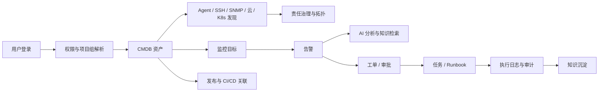

### 1.2 推荐使用顺序

1. 管理员完成用户、角色、项目组和功能权限配置。
2. 运维人员录入或自动发现资产。
3. 资产负责人和相关关系治理。
4. 监控目标接入 Prometheus。
5. 任务模板、工单流程和 Runbook 策略配置。
6. 发布、知识库和 AI 分析逐步启用。

## 2. 用户、角色与权限

### 2.1 登录

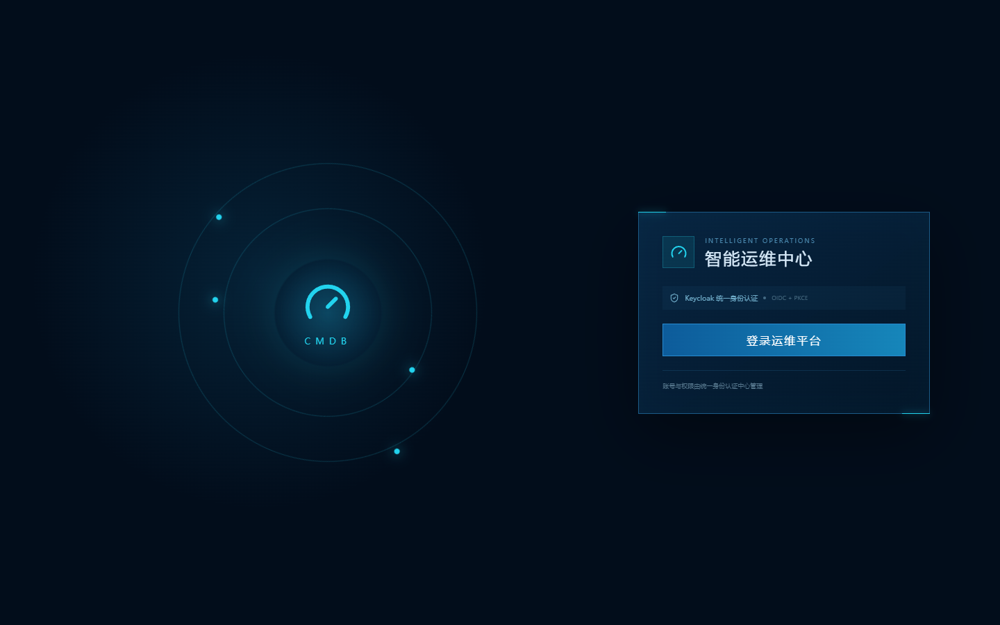

操作步骤：

1. 打开平台地址；
2. 点击“登录运维平台”；
3. 在 Keycloak 页面输入用户名和密码；
4. 首次登录后由管理员配置角色、项目组和数据范围。

### 2.2 权限模型

平台采用“功能权限 + 项目组/标签数据范围”模型：

| 权限 | 能力 |
|---|---|
| `dashboard:view` | 查看全局态势 |
| `cmdb:view` | 查看资产、机房、K8s 资产和拓扑 |
| `cmdb:manage` | 新增、编辑、导入和治理资产 |
| `discovery:view` | 查看发现任务、Agent、凭证和采集质量 |
| `discovery:manage` | 执行发现、部署 Agent、维护采集计划 |
| `topology:view` | 查看业务、物理网络、VLAN 和 CI/CD 拓扑 |
| `monitor:view` | 查看指标、告警和监控目标 |
| `monitor:manage` | 维护规则、静默、路由和通知渠道 |
| `job:view` | 查看任务模板、执行记录和日志 |
| `job:manage` | 创建、执行、审批和调度任务 |
| `ticket:view` | 查看和处理工单 |
| `ticket:manage` | 创建、分派、审批和关闭工单 |
| `release:view` | 查看发布流水线、制品和 CI/CD 资源 |
| `release:manage` | 创建发布、审批、执行和回滚 |
| `toolbox:use` | 使用排查工具 |
| `aiops:view` | 查看 AI 分析、Runbook 和知识库 |
| `aiops:execute` | 执行分析、发布知识和运行受控 Runbook |
| `system:manage` | 系统用户、角色、模块、审计和生产就绪 |
| `knowledge:*` | 知识库查看、创建、编辑、发布、删除和 ACL 管理 |

建议角色：

| 角色 | 典型权限 |
|---|---|
| 平台管理员 | `platform-admin`，全部功能权限和全部数据 |
| 只读用户 | 仪表盘、CMDB、拓扑、监控只读 |
| 项目组编辑 | CMDB 编辑、发现、任务、监控，限本组数据 |
| 值班人员 | 监控、告警、工单、任务查看和处理 |
| 发布管理员 | 发布中心、制品、审批和回滚 |
| 知识库编辑者 | 知识查看、创建、编辑、发布，按目录 ACL 受限 |

### 2.3 用户与角色维护

进入“系统管理”后：

1. 点击“同步 Keycloak”，同步用户、角色和组；
2. 在“用户与组织”中编辑数据范围；
3. 在“角色与数据权限”中维护功能权限和项目组；
4. 在“审计日志”中检查登录、权限和配置变更；
5. 用户禁用、密码重置和 MFA 在 Keycloak 中完成。

注意：前端隐藏按钮只是体验优化，最终权限由 Gateway 服务端强制校验。

---

## 3. 全局态势

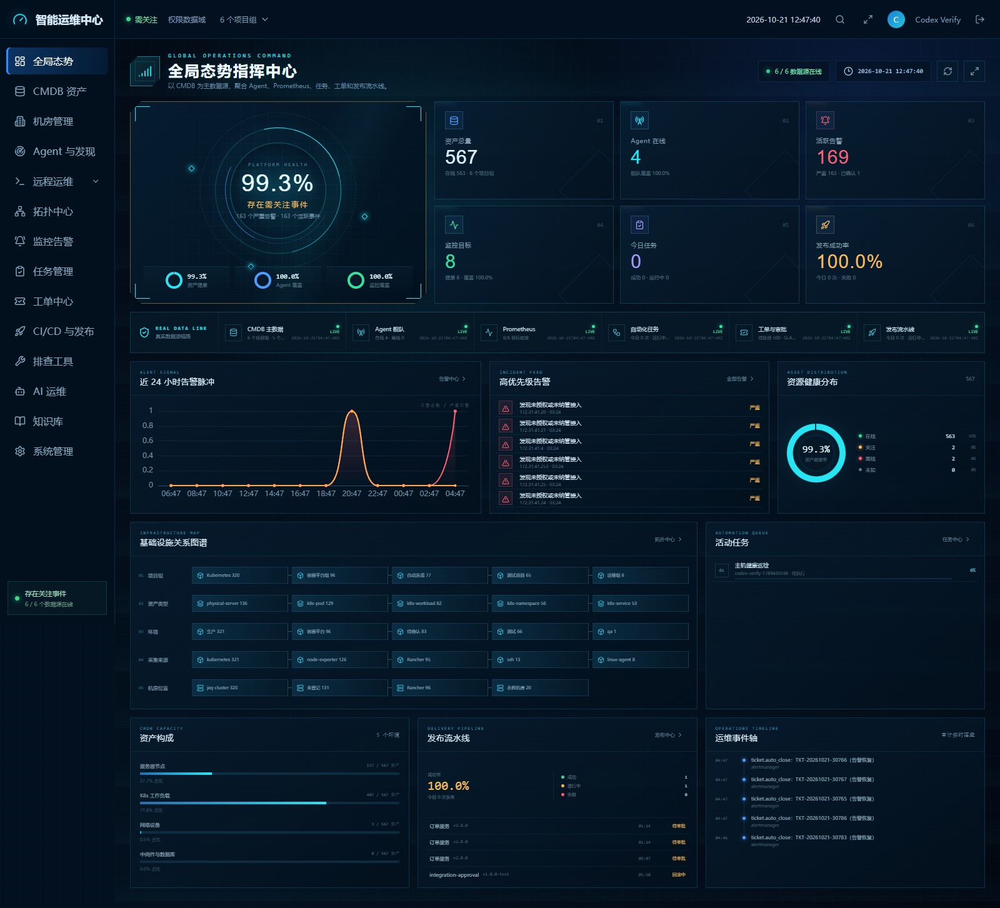

主要功能：

| 区域 | 说明 |
|---|---|
| 平台核心 | 资产健康率、Agent 覆盖率、监控覆盖率，以及严重告警和活跃事件数量 |
| 资产总量 | 当前权限范围内的资产数量、在线资产和项目组数量 |
| Agent 在线 | 当前在线的 Agent 数量与舰队覆盖率 |
| 活跃告警 | 未恢复告警、严重告警和已确认告警数量 |
| 监控目标 | Prometheus 目标数量、健康目标数和监控覆盖率 |
| 今日任务 | 当日任务总数、成功数、失败数和运行中任务 |
| 发布成功率 | 已完成发布的成功率、今日发布量和失败数 |
| 真实数据源链路 | CMDB、Agent、Prometheus、任务、工单和发布六类数据源的连接状态、规模和更新时间 |
| 告警趋势 | 近 24 小时真实告警的分时统计 |
| 高优先级告警 | 当前权限范围内未恢复的高优先级告警 |
| 基础设施关系图谱 | 项目组、资产类型、环境、采集来源和机房位置的真实聚合关系 |
| 资源健康分布 | 在线、关注、离线和未知资产数量与占比 |
| 资产构成 | 服务器、K8s 工作负载、网络设备、中间件和数据库占比 |
| 发布流水线 | 最近发布、运行状态、成功与失败数量 |
| 运维事件轴 | 当前权限范围内的审计、自动建单和自动关闭事件 |

使用步骤：

1. 先确认顶部系统状态和当前权限数据域；
2. 查看平台核心环与六个 KPI，判断全局是否存在需要处置的事件；
3. 检查“真实数据源链路”，确认六类数据源均有真实返回；
4. 从“高优先级告警”进入监控，从“活动任务”进入任务中心；
5. 在“运维事件轴”确认自动建单、自动关闭和发布动作是否正常。

数据说明：

- 大屏每 30 秒刷新一次，右上角刷新按钮可立即重新拉取；
- 页面不包含演示数字或随机数据，空数据会明确显示空态；
- 普通用户只统计项目组和标签权限范围内的数据；
- 无权限返回的数据不会用平台全量数据补齐。

---

## 4. CMDB 资产中心

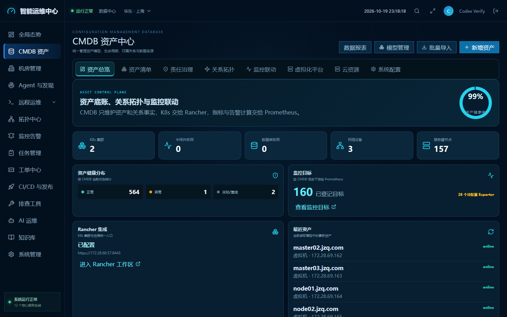

### 4.1 资产总览

查看资产规模、健康分布、监控目标、Rancher 集成和最近资产。点击卡片可进入对应清单或监控详情。

### 4.2 资产清单

使用步骤：

1. 选择资产类型、状态、项目组或输入关键字；
2. 点击资产行打开详情；
3. 查看基础信息、扩展属性、负责人、机房位置、关系和历史；
4. 点击“编辑”修改资产；
5. 点击“新增资产”录入单台资产。

资产字段包括：

- 资产编号、名称、类型、状态、IP；
- 环境、项目组、负责人、机房、机柜、U 位；
- 标签、采集来源、操作系统、业务系统；
- 自定义扩展属性，例如带外地址、模块、序列号。

### 4.3 责任治理

用于发现无负责人、无项目组、无标签、无监控目标等资产问题。可按治理规则批量确认、分派和修复。

### 4.4 关系拓扑

展示资产之间的依赖、承载、连接和所属关系。点击节点可打开资产详情；关系变化会写入变更历史。

### 4.5 监控联动

展示资产是否已纳入 Prometheus、是否有 Exporter、是否已关联告警。可直接跳转监控目标或发现页面。

### 4.6 虚拟化平台

配置 VMware 地址、账号和密钥，测试连接后同步集群、ESXi 主机和虚拟机。同步后的资产带有采集来源和虚拟化标签。

### 4.7 云资源

支持华为云、AWS、腾讯云、OpenStack 等云账号配置和资源同步。云主机、存储和网络资源可关联到项目组。

### 4.8 数据报表

按类型、环境、项目组、状态等维度统计资产，可导出 CSV。报表只统计当前用户有权限查看的数据。

### 4.9 模型管理

维护 CI 模型、字段、字段类型、必填项、展示分组和扩展属性。模型变更会影响新增和编辑表单。

### 4.10 批量导入

1. 下载 CSV 模板；
2. 按表头填写资产；
3. 上传文件并选择“新增”或“更新”；
4. 查看成功、失败和重复行；
5. 导入完成后在资产清单中复核。

### 4.11 K8s 资产

K8s 资产从 Rancher/Kubernetes 采集，按集群、命名空间、工作负载、Pod、Service、Ingress、PVC、PV 和 StorageClass 分类。详情页可查看容量卡片和关联关系。

---

## 5. 机房管理

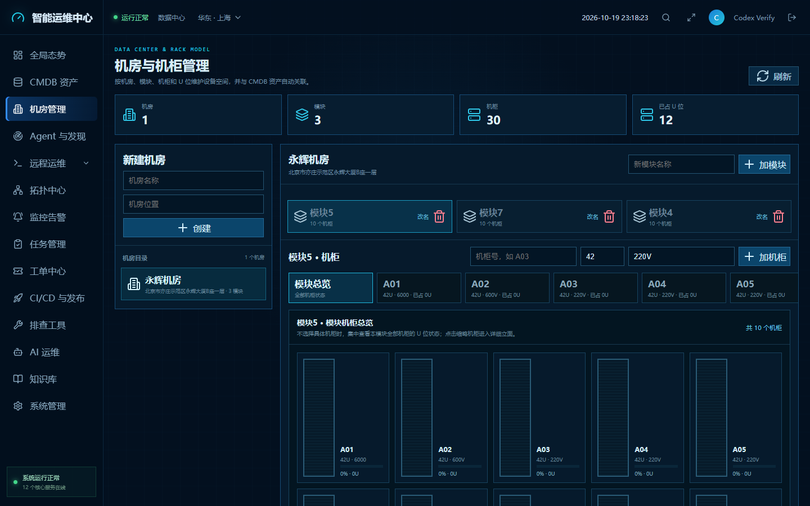

功能明细：

| 功能 | 说明 |
|---|---|
| 机房 | 名称、地址、区域、负责人、描述 |
| 模块 | 机房下的逻辑分区或楼层模块 |
| 机柜 | 机柜编号、位置、容量、电压、状态 |
| U 位 | 设备占用的起始 U 位和高度 |
| 设备关联 | 物理资产绑定到机柜和 U 位 |

使用步骤：

1. 新建机房；
2. 在机房下新建模块；
3. 在模块下新建机柜，填写总 U 数和电力信息；
4. 在资产编辑页选择机房、机柜和 U 位；
5. 在机房视图中检查容量和设备占用。

---

## 6. Agent 与自动发现

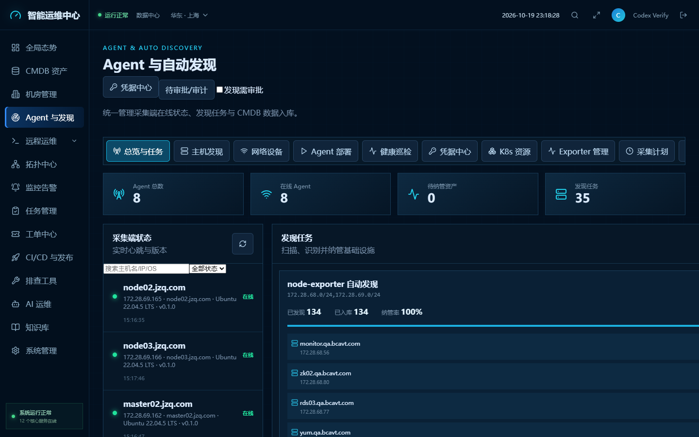

### 6.1 总览与任务

查看 Agent 总数、在线数、待纳管资产、发现任务和纳管率。发现任务完成后会生成待确认或已入库资产。

### 6.2 主机发现

按网段、IP、端口、协议和凭证发起发现。支持：

- SSH；
- Node Exporter；
- SNMP v2；
- Redfish 带外；
- Kubernetes/Rancher；
- VMware 和云平台。

### 6.3 网络设备

配置 SNMP 团体名、版本、端口和厂商模板，采集设备型号、接口、VLAN、MAC、ARP 和链路信息。

### 6.4 Agent 部署

1. 选择 Linux 或 Windows；
2. 输入目标主机、SSH/WinRM 端口和凭证；
3. 执行预检查；
4. 安装或升级 Agent；
5. 在“健康巡检”确认在线状态。

### 6.5 健康巡检

查看 Agent 心跳、版本、主机名、IP、操作系统、最后上报时间和离线原因。

### 6.6 凭证中心

维护 SSH、SNMP、云平台和 API 凭证。密码和私钥优先存入 Vault，列表只显示脱敏信息。

### 6.7 Exporter 管理

查看 Node Exporter、SNMP Exporter、数据库 Exporter 的端口、状态和 Prometheus 接入情况。

### 6.8 采集计划

配置周期发现、失败重试、并发、网段范围和通知策略。任务执行记录可审计。

---

## 7. 远程运维

### 7.1 远程运维概览

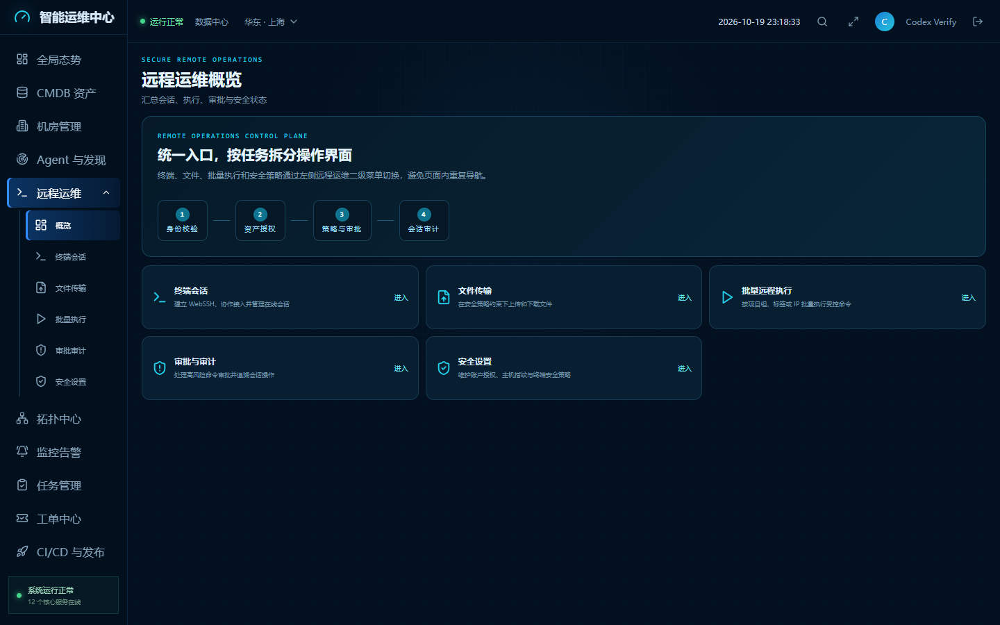

远程运维按任务拆分：终端会话、文件传输、批量执行、审批审计和安全设置。

### 7.2 终端会话

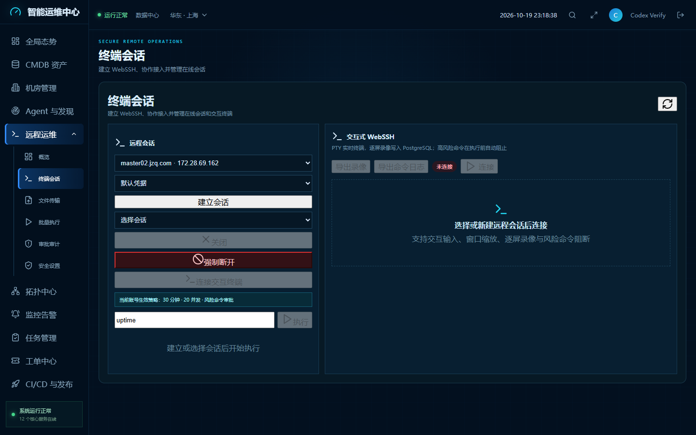

使用步骤：

1. 选择目标资产或输入 IP；
2. 选择凭证和终端类型；
3. 建立 WebSSH 会话；
4. 高风险命令触发审批；
5. 会话结束后查看录像和审计记录。

### 7.3 文件传输

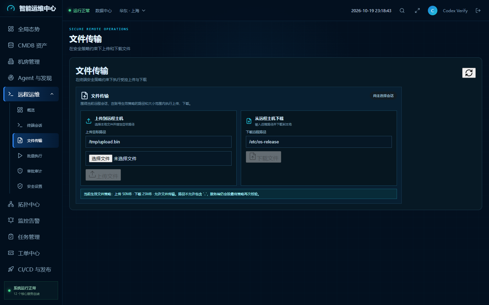

在目标主机上上传或下载文件。路径、大小、哈希和操作者均写入审计；批量分发受项目和资产范围限制。

### 7.4 批量执行

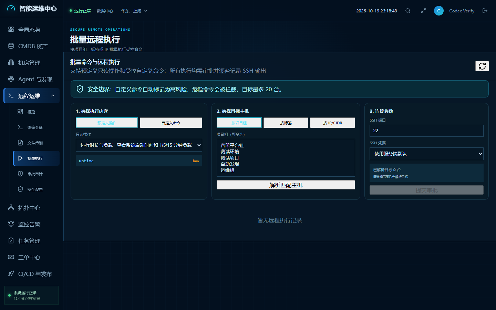

支持按项目组、标签或 IP 选择目标，输入命令后统一执行。执行前显示目标数量和风险提示。

### 7.5 审批审计

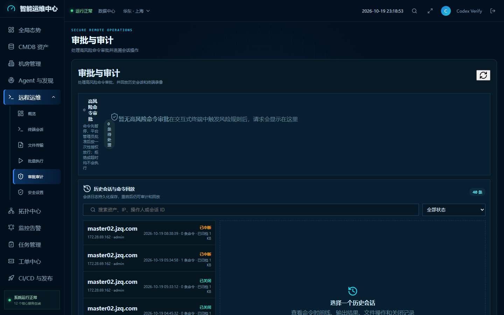

高风险管理操作进入审批队列。审批人可查看命令、目标、申请人、风险和过期时间，批准后才允许执行。

### 7.6 安全设置

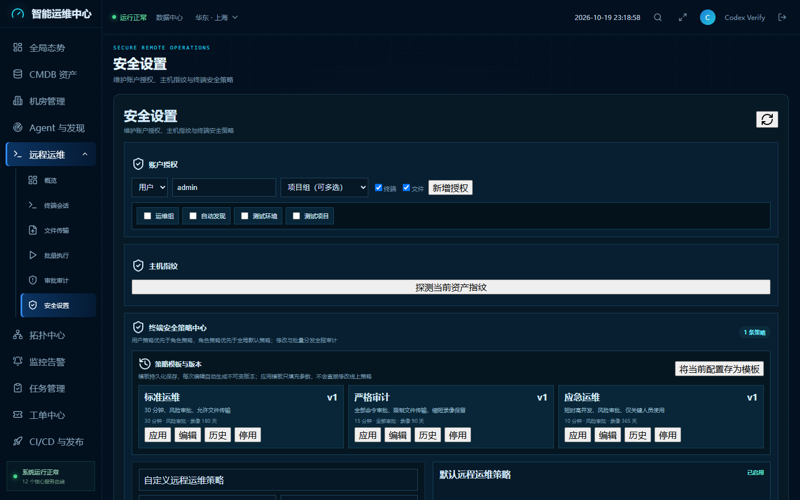

维护主机指纹、已知主机、危险命令策略、会话租约和账号授权。生产环境建议开启严格主机密钥校验。

---

## 8. 拓扑中心

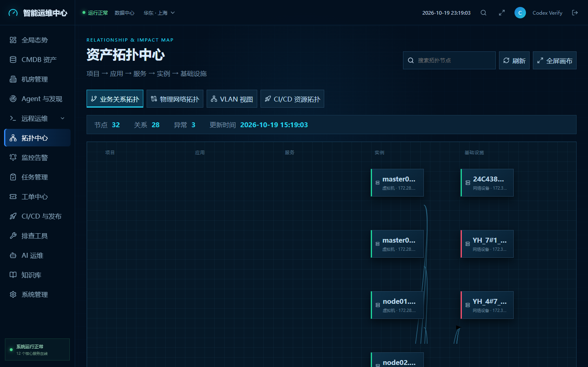

### 8.1 业务关系拓扑

按“项目 → 应用 → 服务 → 实例 → 基础设施”展示业务依赖，节点异常以颜色标识。

### 8.2 物理网络拓扑

展示服务器网卡、交换机端口、链路和 VLAN 关系，用于定位物理链路故障。

### 8.3 VLAN 视图

按 VLAN 查看设备、接口和成员关系，辅助网络变更和故障排查。

### 8.4 CI/CD 资源拓扑

把 Argo CD Application、Harbor 制品和 CMDB 资产关联，查看发布影响范围。

操作：

1. 输入节点名称搜索；
2. 点击节点查看属性和关联资产；
3. 使用“全屏画布”查看大型拓扑；
4. 从异常节点直接进入资产或告警详情。

---

## 9. 监控告警中心

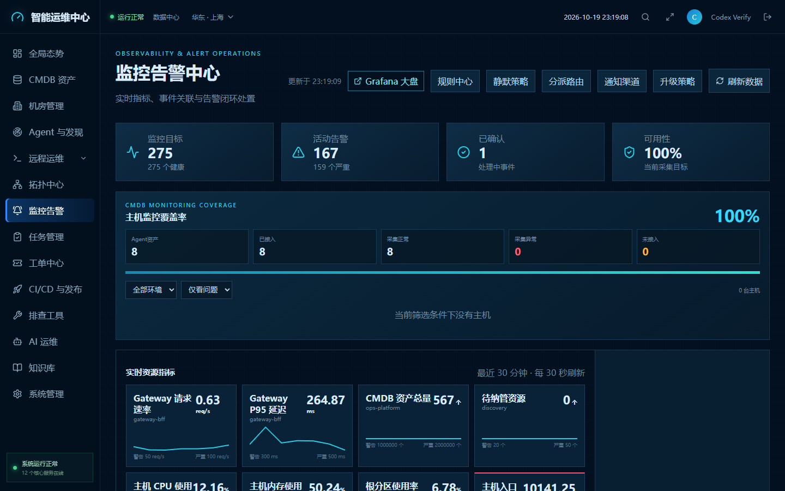

### 9.1 指标与覆盖率

查看监控目标、活动告警、确认数和可用性；主机覆盖率显示 Agent 资产、已接入、采集正常、异常和未接入数量。

### 9.2 告警处置

告警列表支持：

- 按严重级别、状态、环境、资产过滤；
- 确认、静默、分派、恢复和转工单；
- 查看指标趋势、事件和关联资产；
- 打开 Grafana 或排查工具。

### 9.3 规则中心

创建、编辑、启停和删除 Prometheus 告警规则。保存后校验 PromQL，并触发热加载。

### 9.4 静默策略

按匹配器、时间范围和原因创建静默。静默到期自动失效，操作写入审计。

### 9.5 分派路由

按标签、严重级别、项目组和服务选择通知渠道和接收人。

### 9.6 通知渠道

配置 Webhook、企业微信、钉钉等渠道。生产环境需配置 `WEBHOOK_ALLOWED_HOSTS` 白名单。

### 9.7 升级策略

定义告警未确认或未恢复时的升级层级、等待时间和接收人。

---

## 10. 任务管理

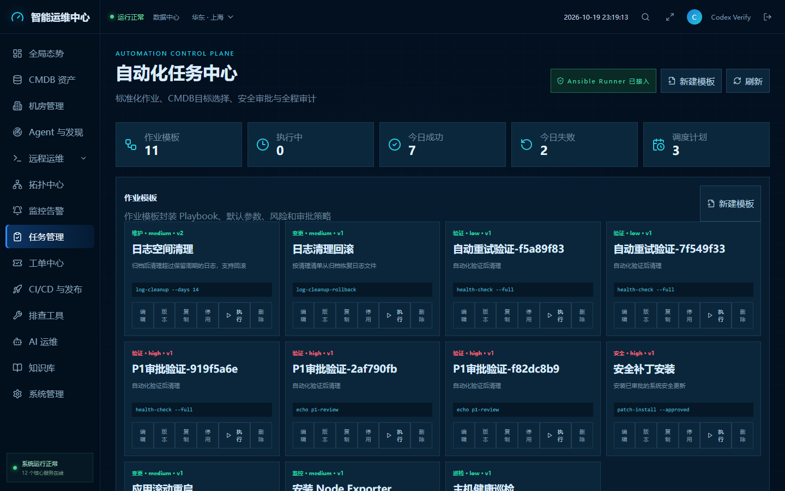

### 10.1 作业模板

模板封装 Playbook、默认参数、风险等级、审批策略和目标范围。支持：

- 健康巡检；
- 日志清理；
- 日志清理回滚；
- 安装 Node Exporter；
- 应用滚动重启；
- 安全补丁安装。

### 10.2 新建模板

1. 点击“新建模板”；
2. 填写名称、分类、风险级别；
3. 选择 Playbook 或命令；
4. 配置变量、常量和目标选择方式；
5. 设置是否需要审批；
6. 保存并执行。

### 10.3 批量执行

可按项目组、标签、IP 或资产清单选择目标；执行前显示目标数量、风险和影响范围。

### 10.4 调度计划

配置一次性、周期性和 Cron 计划；支持暂停、恢复、克隆和下次执行时间预览。

### 10.5 执行日志

查看实时日志、结果摘要、失败主机、返回码、耗时和归档下载。失败可按主机重试。

### 10.6 审批与回滚

高风险模板必须审批。执行完成后可查看变更记录和回滚 Playbook。

---

## 11. 工单中心

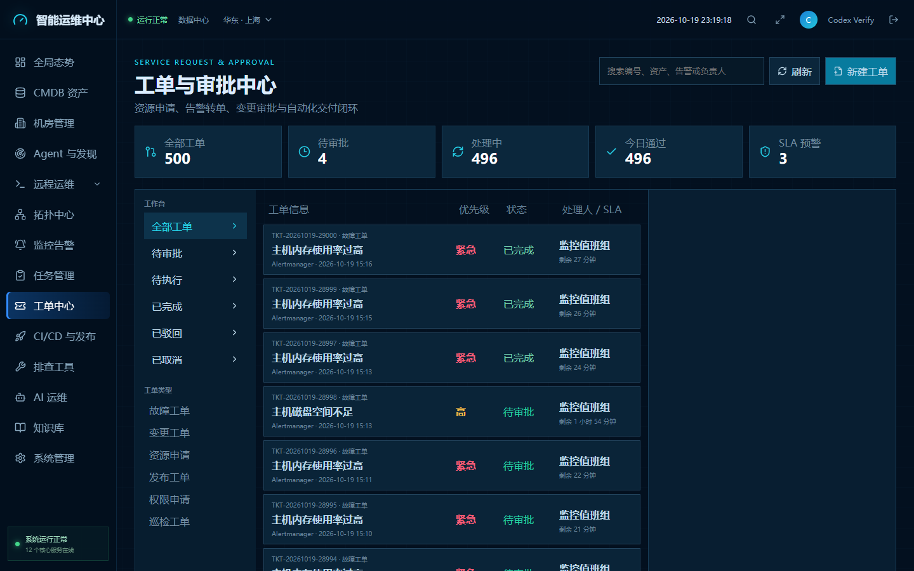

功能：

- 故障工单、变更工单、资源申请、发布工单、权限申请、巡检工单；
- 建单、分派、处理、审批、完成、驳回、取消；
- 优先级、SLA、剩余时间预警；
- 告警自动转工单；
- 关联资产、告警、任务、发布和知识；
- 处理记录和时间线。

操作流程：

1. 点击“新建工单”；
2. 选择类型、优先级和项目组；
3. 填写标题、描述、影响范围；
4. 关联资产或告警；
5. 提交后由审批人或处理人接单；
6. 完成后填写处理结果并关闭。

---

## 12. CI/CD 与发布管理

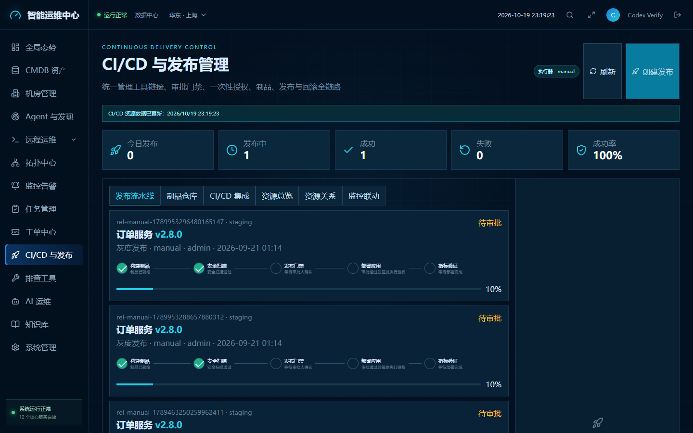

功能模块：

| 模块 | 说明 |
|---|---|
| 发布流水线 | 创建发布、审批、执行、验证和回滚 |
| 制品仓库 | 浏览 Harbor 镜像、标签和摘要 |
| CI/CD 集成 | 配置 Harbor、Argo CD、GitLab |
| 资源总览 | 查看应用、环境、集群和部署状态 |
| 资源关系 | 关联 CMDB 资产与发布对象 |
| 监控联动 | 发布窗口内的指标和告警 |

发布步骤：

1. 创建发布，选择应用、版本、环境和策略；
2. 关联制品和变更工单；
3. 执行安全扫描和发布门禁；
4. 审批人确认变更窗口和回滚方案；
5. 执行发布并观察指标；
6. 失败时按回滚方案恢复；
7. 完成后归档发布记录。

---

## 13. 排查工具箱

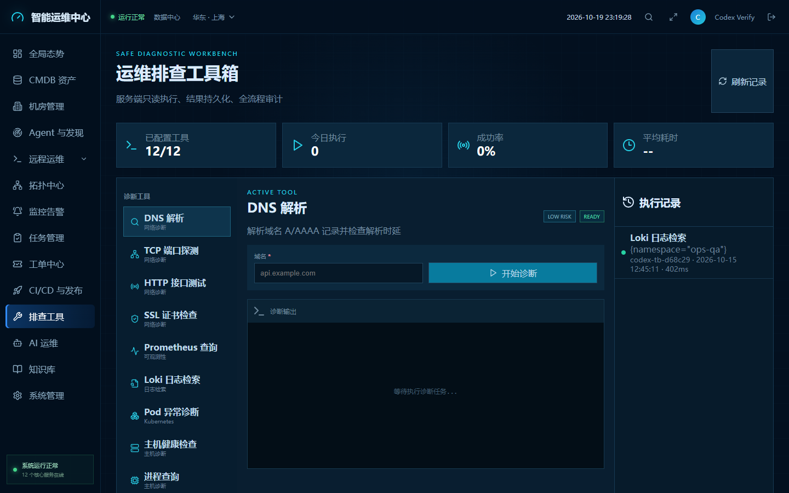

支持：

- Prometheus 即时查询；
- Loki 日志检索；
- Kubernetes Pod、事件、日志和资源诊断；
- 主机 CPU、内存、磁盘、网络检查；
- 网络连通性、端口和 DNS 检查；
- 只读命令白名单和超时控制。

使用原则：

1. 优先使用只读工具；
2. 明确目标资产和环境；
3. 不把密码、Token 写入命令；
4. 高风险命令通过远程运维审批流程。

---

## 14. AIOps 智能分析

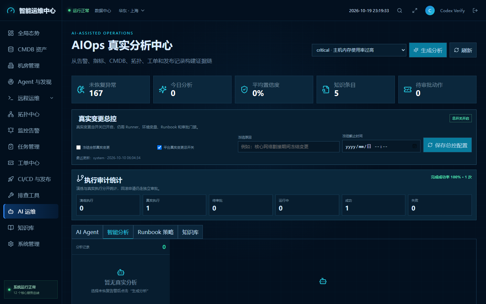

### 14.1 告警分析与证据链

1. 选择未恢复告警；
2. 点击“生成分析”；
3. 查看指标、日志、资产、工单、发布和历史反馈证据；
4. 查看根因假设、置信度和建议步骤；
5. 提交“有帮助 / 无帮助 / 纠正”反馈。

### 14.2 AI Agent

在 AI Agent 中提问，例如：

- “当前有多少台物理服务器？”
- “哪些资产位于华东机房？”
- “这个告警应该先查什么？”

Agent 会调用资产、告警和知识检索工具，引用结果受当前用户权限限制。

### 14.3 Runbook 策略

查看 Runbook、审批要求、风险等级和允许执行的环境。真实变更必须通过任务和工单审批，不能由 AI 直接执行。

### 14.4 真实变更总控

设置平台真实变更总开关、冻结原因和冻结截止时间。冻结期间所有真实变更应被阻止。

### 14.5 知识库

见第 15 节。

---

## 15. 知识库

### 15.1 知识空间

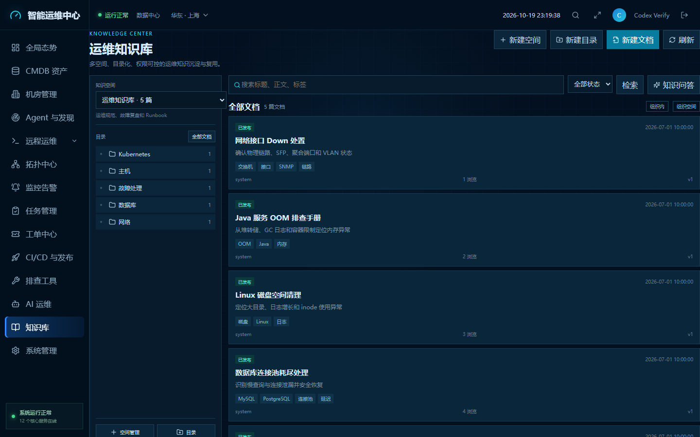

平台支持三类空间：

- 组织空间：面向全组织；
- 项目组空间：按项目组授权；
- 私有空间：每个用户自动创建，仅本人可见。

切换空间后，左侧目录和右侧文档列表只显示当前用户有权访问的内容。

### 15.2 目录管理

1. 点击“新建目录”；
2. 输入名称、上级目录、负责人和排序；
3. 选中目录后点击“编辑”修改或移动；
4. 目录非空时不能直接删除，需先移动或归档文档。

### 15.3 新建文档与双编辑器

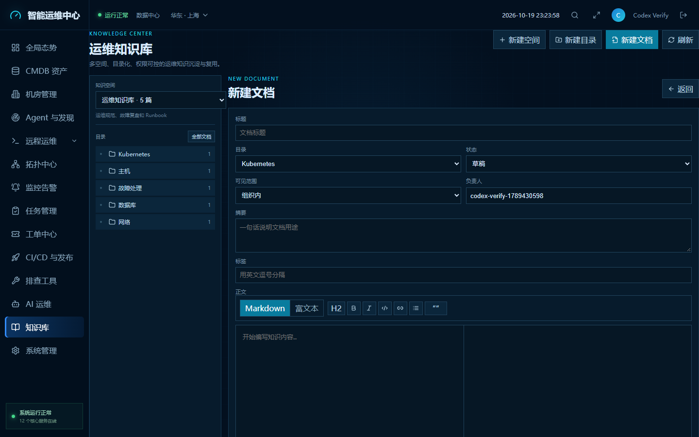

1. 点击“新建文档”；
2. 选择目录、状态、可见范围和负责人；
3. 输入标题、摘要和标签；
4. 在“Markdown / 富文本”之间切换；
5. Markdown 支持标题、列表、粗体、代码、链接和实时预览；
6. 富文本支持标题、粗体、斜体、下划线、列表、引用、代码和链接；
7. 点击“保存草稿”或“保存并发布”。

编辑者可以直接发布。发布后文档进入检索和 RAG 范围。

### 15.4 版本和更新

每次保存、发布、归档和还原都会生成版本。打开文档后点击“版本”，可查看版本号、修改人、时间和说明，并还原到历史版本。

### 15.5 权限

目录和文档权限支持：

- 用户、角色、项目组；
- 查看、编辑、发布、管理；
- allow / deny；
- 是否向下继承。

私有空间的所有者隔离优先于管理员权限，其他用户不能通过旧接口、搜索或 RAG 读取。

### 15.6 附件

支持上传、下载和删除附件。附件保存在 MinIO/S3，下载时再次校验文档权限。

### 15.7 知识问答

在知识库页面点击“知识问答”，输入问题。回答只引用当前用户有权查看的已发布知识，并显示引用文档。

---

## 16. 系统管理

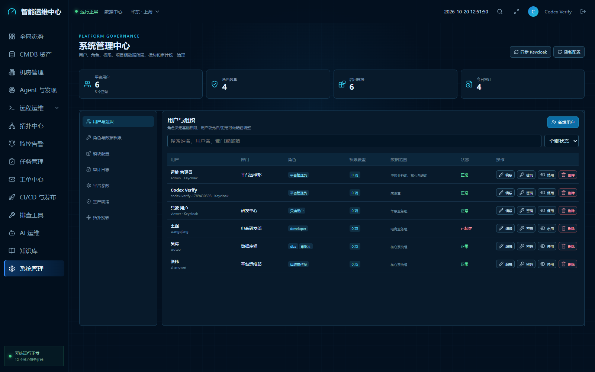

### 16.1 用户与组织

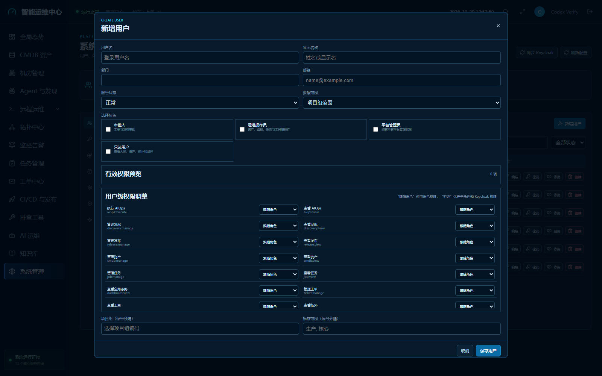

查看用户、部门、角色、权限覆盖、数据范围、项目组/标签、状态和最后登录。

新增用户：

1. 点击“新增用户”；
2. 填写用户名、显示名称、部门、邮箱和账号状态；
3. 选择一个或多个角色；
4. 在“用户级权限调整”中按需设置“额外允许”或“明确拒绝”；
5. 配置项目组和标签数据范围；
6. 保存后复制一次性初始密码交给用户。

用户行支持编辑、重置密码、停用/启用和删除。删除会禁用 Keycloak 账号、撤销会话，并将平台用户放入回收站。

### 16.2 角色与数据权限

维护角色与功能权限映射，配置全部资产、项目组或标签范围。角色名称中的冒号表示功能权限，例如 `cmdb:manage`。

- 点击“新建角色”创建自定义角色；
- 在权限矩阵中按模块选择权限；
- 系统角色受保护，不能删除；
- 自定义角色只有在没有被用户使用时才能删除；
- 平台超级管理员固定拥有全部权限；
- 角色权限变更后，相关用户的认证缓存会立即失效。

### 16.3 模块配置

控制模块是否在导航中显示，以及模块名称、排序和权限入口。

### 16.4 审计日志

查询登录、资产、权限、任务、知识、发布和系统配置操作。审计记录包含操作者、对象、时间、来源和结果。

### 16.5 平台参数

维护环境、项目组、标签、Webhook、保留周期和其他平台级配置。

### 16.6 生产就绪

检查数据库、Redis、Kafka、Keycloak、Vault、MinIO、Neo4j、OpenSearch、Prometheus、Loki、Tempo、Runner 等依赖，并显示缺失项。

### 16.7 授权与用量

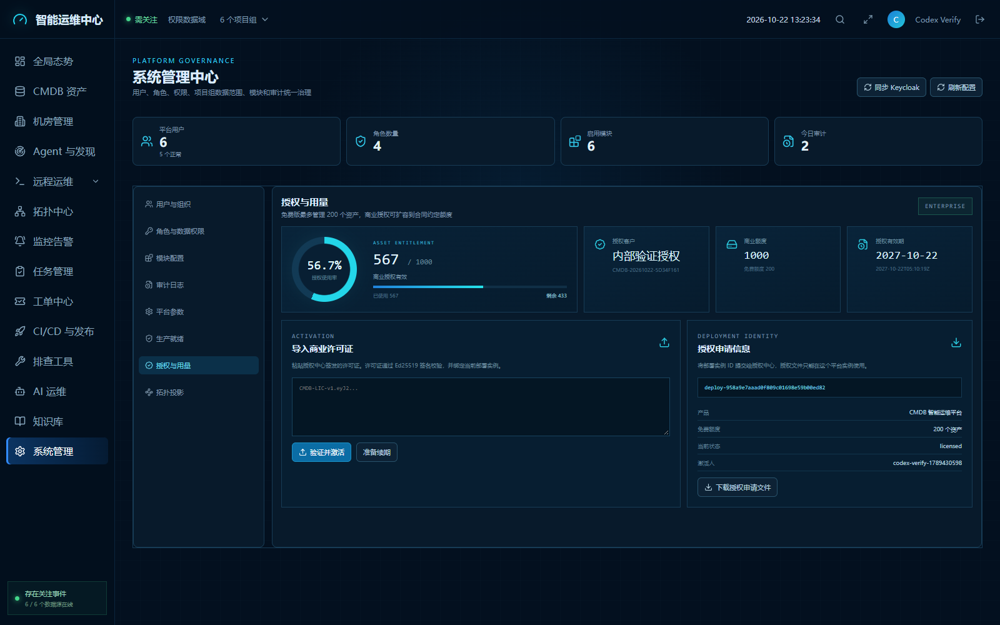

系统管理中的“授权与用量”用于查看和管理平台商业许可证：

- 社区版永久免费，最多管理 200 个资产；
- 第 201 个新资产开始需要商业许可证；
- 页面显示已用额度、剩余额度、客户、许可证编号和有效期；
- 额度达到 80% 时显示预警，达到 100% 后停止新增但保留已有数据；
- 点击“下载授权申请文件”获取 Deployment ID，并提交给授权管理员；
- 粘贴 `.license` 内容后点击“验证并激活”；
- 续期或扩容时直接导入新许可证，不需要重启平台。

独立授权签发网站：

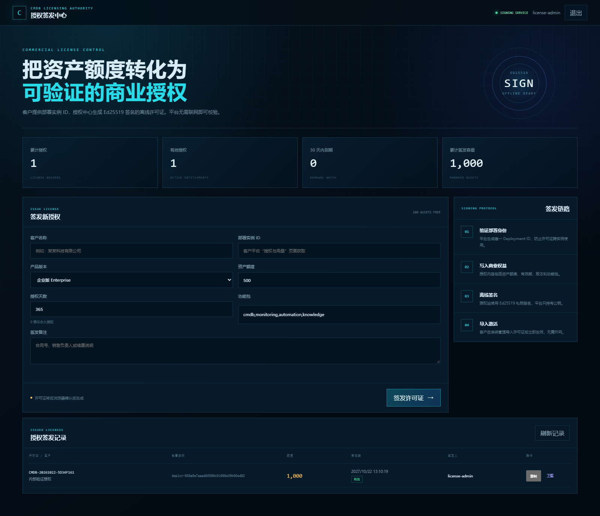

签发流程：

1. 授权管理员登录独立签发网站；
2. 输入客户名称、平台授权申请文件中的 Deployment ID、资产额度和有效期；
3. 点击“签发许可证”；
4. 下载 `.license` 文件或复制许可证内容；
5. 客户平台管理员在“系统管理 → 授权与用量”导入并激活。

许可证采用 Ed25519 离线签名，正式平台只保存公钥。私钥仅存在于授权签发站，
客户平台不需要连接外网即可验证。

### 16.8 拓扑投影

查看 Neo4j/OpenSearch 投影状态，手动重建或检查最近同步结果。

---

## 17. 典型使用流程

### 17.1 新资产纳管

### 17.2 告警处置

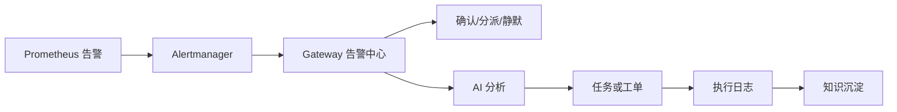

### 17.3 发布变更

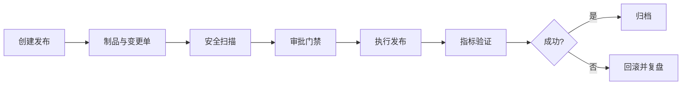

## 18. 常见问题

| 问题 | 处理 |
|---|---|
| 登录后没有菜单 | 检查 Keycloak Realm 角色是否包含对应功能权限 |
| 看不到某些资产 | 检查项目组/标签数据范围 |
| 任务执行按钮不可用 | 检查 `job:manage`、Runner 状态和审批策略 |
| 知识库看不到空间 | 检查 `aiops:view` 或 `knowledge:view`，以及目录/文档 ACL |
| 上传附件失败 | 检查 MinIO/S3、Bucket 和对象存储网络 |
| AI 回答没有引用 | 检查 Embedding 配置、知识发布状态和当前用户权限 |
| 告警没有进入平台 | 检查 Alertmanager webhook、Gateway 地址和鉴权 |
| 发布操作不可用 | 检查 CI/CD 集成凭证、发布权限和冻结窗口 |

## 19. 页面索引

| 页面 | 地址 |
|---|---|
| 登录 | `/login` |
| 全局态势 | `/` |
| CMDB | `/cmdb` |
| 机房 | `/idc` |
| Agent 与发现 | `/discovery` |
| 远程运维 | `/remote/overview` |
| 拓扑 | `/topology` |
| 监控 | `/monitor` |
| 任务 | `/jobs` |
| 工单 | `/tickets` |
| 发布 | `/releases` |
| 排查工具 | `/toolbox` |
| AI 运维 | `/aiops` |
| 知识库 | `/knowledge` |
| 系统管理 | `/system` |
